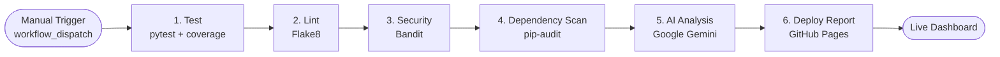

# 🚀 AI-Powered CI/CD Pipeline

> An end-to-end **DevSecOps** pipeline built on GitHub Actions that tests, scans, analyzes and publishes a live engineering dashboard on every run, with AI-generated insights powered by Google Gemini.


**🌐 Live Dashboard:** [itsakrana.github.io/AI-Powered-CI-CD](https://itsakrana.github.io/AI-Powered-CI-CD/)

---

## 📖 Overview

Most CI/CD pipelines tell you that a build failed. This project explains **why it matters**.

On every run, the pipeline validates code quality, scans for security risks and vulnerable dependencies, then sends the combined results to **Google Gemini**, which produces a plain-language health summary with prioritized DevOps recommendations. Everything is consolidated into a single **AI DevOps Dashboard** published automatically to GitHub Pages, so any team member can understand the health, risk and security posture of a build in seconds.

## ✨ Key Features

- ✅ **Automated testing** with `pytest` and an enforced **80% code-coverage quality gate**
- 🧹 **Static code analysis** with `Flake8`
- 🔐 **Security scanning (SAST)** with `Bandit` to detect issues such as hardcoded credentials
- 📦 **Dependency vulnerability scanning (SCA)** with `pip-audit` against known CVEs
- 🤖 **AI-driven analysis** with Google Gemini: pipeline health summary, risk observations and actionable recommendations
- 📊 **Live AI DevOps Dashboard** showing deployment status, risk score, test results, coverage and links to every detailed report
- 🛡️ **Resilient AI integration** with retry and backoff plus multi-model fallback, so an API outage never blocks report delivery
- 🔗 **Shared status artifact** passed through every job as a single source of truth

## 🏗️ Pipeline Architecture



| Stage | Job | Tool | What it does |
|-------|-----|------|--------------|
| 1 | `test` | pytest, pytest-cov | Runs the test suite and fails the build if coverage is below 80% |
| 2 | `lint` | Flake8 | Checks code style and quality, generates an HTML report |
| 3 | `security` | Bandit | Scans application code for common security issues |
| 4 | `dependency-scan` | pip-audit | Audits every dependency for known vulnerabilities and builds a visual report |
| 5 | `ai-analysis` | Gemini API | Analyzes the combined results and writes an AI summary with recommendations |
| 6 | `deploy-report` | GitHub Pages | Packages all reports and publishes the dashboard |

Each stage updates a shared `status.json` file that is passed to the next job as an artifact:

```json
{
  "tests": "passed",
  "coverage": 85.0,
  "lint": "warning",
  "security": "warning",
  "dependency": "passed"
}
```

> Scanners report a `warning` state when they find issues. This is the pipeline working as designed: findings are surfaced on every run without blocking report delivery.

## 📸 Screenshots

| Dashboard | Security Report |
|-----------|-----------------|
|  |  |

| Dependency Report | AI Insights |
|-------------------|-------------|
|  |  |

## 🛠️ Tech Stack

| Category | Technologies |
|----------|--------------|
| CI/CD | GitHub Actions, GitHub Pages |
| Language and framework | Python 3.11, FastAPI |
| Testing | pytest, pytest-cov, pytest-html |
| Code quality | Flake8, flake8-html |
| Security | Bandit (SAST), pip-audit (SCA) |
| AI | Google Gemini API |
| Tooling | YAML, jq, curl |

## 📁 Project Structure

```
.
├── .github/
│   └── workflows/
│       └── <workflow>.yml     # AI CI/CD pipeline definition
├── app/                       # FastAPI application
├── reports/
│   └── index.html             # AI DevOps Dashboard (home page)
├── requirements.txt
└── README.md
```

## ⚙️ Getting Started

### Prerequisites

- A GitHub account and a fork or clone of this repository
- A free [Google Gemini API key](https://aistudio.google.com/apikey)

### 1. Add the Gemini API key

In your repository, go to **Settings → Secrets and variables → Actions → New repository secret** and add:

| Name | Value |
|------|-------|
| `GEMINI_API_KEY` | Your Gemini API key |

### 2. Run the pipeline

1. Open the **Actions** tab
2. Select **AI CI/CD Pipeline**
3. Click **Run workflow**

### 3. Enable GitHub Pages

After the first successful run, go to **Settings → Pages** and set:

- **Source:** Deploy from a branch
- **Branch:** `gh-pages` / `(root)`

Your dashboard will be available at:

```
https://<your-username>.github.io/<repository-name>/
```

## 📊 Reports Published

| Report | Path |
|--------|------|
| Dashboard (home) | `/` |
| Test and coverage report | `/test-report/report.html` |
| Lint report | `/lint-report/flake8-report/index.html` |
| Security report | `/security-report/bandit-report.html` |
| Dependency report | `/dependency-report/dependency-report.html` |
| AI insights | `/ai-report/ai-report.txt` |
| Raw status data | `/status.json` |

## 🧪 Run Checks Locally

```bash
# Install dependencies
pip install -r requirements.txt
pip install pytest pytest-cov pytest-html flake8 bandit pip-audit

# Tests with coverage gate
PYTHONPATH=. pytest --cov=app --cov-fail-under=80

# Lint
flake8 . --max-line-length=120

# Security scan
bandit -r app/

# Dependency audit
pip-audit -r requirements.txt
```

## 🔧 Configuration

| What | Where | Notes |
|------|-------|-------|
| Coverage threshold | `--cov-fail-under=80` in the `test` job | Raise or lower to match your standards |
| Lint line length | `--max-line-length=120` in the `lint` job | Adjust to your style guide |
| Gemini models | `MODELS` variable in the `ai-analysis` job | Tried in order, with retries on 429 and 5xx errors. Update when Google retires a model |
| AI step blocking | `continue-on-error: true` on `ai-analysis` | Remove it to make the whole pipeline fail when the AI step fails |

## 🛣️ Roadmap

- [ ] Trigger on push and pull request events
- [ ] Docker image build and container vulnerability scanning
- [ ] Deployment to a cloud environment (AWS)
- [ ] Slack or email notifications with the AI summary
- [ ] Trend charts for coverage and risk score over time

## 👨‍💻 Author

**Ankit Rana**
DevOps and Cloud Engineer

[](https://github.com/itsakrana)

---

⭐ If you found this project useful, consider giving it a star!
